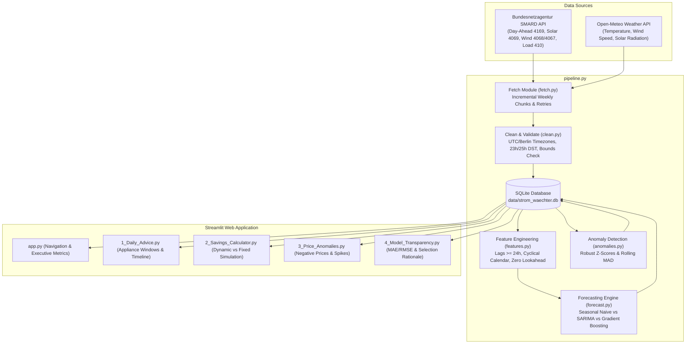

# ⚡ Strom-Wächter

> **Wisse, wann Strom günstig ist. Smarte Energieentscheidungen für dein Zuhause.**  
> *Know when electricity is cheap. Make smarter energy decisions.*

[](https://github.com/riddhidineshbhanushali/strom-waechter/actions)
[](https://www.python.org/downloads/)
[](LICENSE)
[](https://streamlit.io/)
[](https://www.sqlite.org/)

---

## 1. Project Overview

**Strom-Wächter** is a production-quality open-source energy analytics platform and household decision engine. It automatically ingests hourly electricity market data from the official German electricity market platform (**Bundesnetzagentur SMARD**), benchmarks multi-model time-series price forecasts, detects extreme price anomalies (negative prices, spikes, ramp jumps), and translates wholesale price dynamics into actionable advice and financial simulations for German households.

### The Problem
Wholesale day-ahead electricity prices in Germany fluctuate hour-by-hour on the EPEX SPOT exchange, frequently dropping to negative values during midday solar or overnight wind peaks, and spiking during evening demand peaks. While dynamic electricity tariffs (e.g. Tibber, Rabot Charge, Ostrom) allow households to capitalize on lower wholesale prices, ordinary consumers face major obstacles:
- **Opacity**: Difficulty knowing when to schedule flexible appliances (washing machines, dryers, dishwashers, EV chargers).
- **Misleading Pricing Claims**: Assuming negative wholesale prices mean electricity is completely "free", ignoring network charges (*Netzentgelte*), taxes, and statutory levies.
- **Tariff Uncertainty**: Inability to estimate whether switching to a dynamic tariff will yield actual net financial savings based on their specific lifestyle.
- **Forecast Distrust**: Black-box forecasts without honest error disclosures or baseline benchmarks.

### The Solution
Strom-Wächter bridges the gap between wholesale energy trading and household reality:
- **Daily Advice**: Translates live market clearing prices into clear traffic-light indicators (🟢 Green / 🟡 Yellow / 🔴 Red) and highlights the cheapest continuous 2-hour and 3-hour appliance windows.
- **Dynamic Savings Calculator**: Simulates true annual household electricity costs across 3 realistic usage profiles (*Evening-heavy*, *Flexible*, *EV Charging*) incorporating all German statutory components (Stromsteuer, Netzentgelte, Konzessionsabgabe, KWKG, Offshore, and 19% VAT).
- **Price Anomaly Detection**: Transparently identifies negative clearing prices, extreme spikes, and rapid hourly price jumps using rolling robust statistics (Median Absolute Deviation).
- **Model Transparency**: Openly benchmarks a **Seasonal Naive Baseline** against **SARIMA / Seasonal Autoregression** and **Gradient Boosting** with chronological backtesting, reporting honest MAE and RMSE metrics.

---

## 2. Target Users

- **Renters & Ordinary Households**: Looking to reduce utility bills by running high-draw appliances during low-price windows.
- **International Students & Flatshares (WGs) in Germany**: Clear bilingual explanations (German/English) explaining how the German energy system works without technical jargon.
- **Prospective Dynamic Tariff Adopters**: Transparently calculating whether switching away from legacy fixed contracts saves money.
- **EV Owners & Heat Pump Operators**: Optimizing overnight and midday charging to capture low or negative wholesale hours.

---

## 3. Technology Stack

- **Core Runtime:** Python 3.11+
- **Interactive UI:** Streamlit
- **Data Engineering:** Pandas 2.2+, NumPy
- **Persistence:** SQLite with Write-Ahead Logging (`WAL` mode)
- **Data Visualization:** Plotly (interactive charts with accessible contrast)
- **Machine Learning & Time Series:** Scikit-learn, Statsmodels, LightGBM (with automated Scikit-learn `HistGradientBoostingRegressor` fallback)
- **API & Networking:** Requests (with exponential backoff and timeout safeguards)
- **Testing:** Pytest (19 comprehensive unit tests)
- **CI/CD & Automation:** GitHub Actions (scheduled daily update pipeline)
- **Deployment:** Streamlit Community Cloud

---

## 4. Architecture Diagram



---

## 5. Verified Data Sources & SMARD Endpoint Structure

Data is ingested from the official German Federal Network Agency (**Bundesnetzagentur SMARD**).

### Endpoint Structure
SMARD publishes data in weekly chunked JSON files organized by filter, region, and resolution:
- **Timestamp Index:**  
  `https://www.smard.de/app/chart_data/{filter}/{region}/index_{resolution}.json`  
  *Example:* `https://www.smard.de/app/chart_data/4169/DE/index_hour.json` (Returns array of epoch milliseconds representing weekly start dates).
- **Weekly Data Chunk:**  
  `https://www.smard.de/app/chart_data/{filter}/{region}/{filter}_{region}_{resolution}_{timestamp_ms}.json`  
  *Example:* `https://www.smard.de/app/chart_data/4169/DE/4169_DE_hour_1794783600000.json` (Returns `{"series": [[epoch_ms, value], ...]}`).

### Verified SMARD Filter IDs
| Filter ID | Category | Name in German | Physical Unit | App Column |
|---|---|---|---|---|
| **4169** | Wholesale Prices | Day-Ahead Börsenpreis (DE/LU) | EUR/MWh | `price_eur_mwh` / `price_ct_kwh` |
| **4069** | Generation | Photovoltaik (Solar) | MWh | `solar_mwh` |
| **4068** | Generation | Wind Onshore | MWh | `wind_onshore_mwh` |
| **4067** | Generation | Wind Offshore | MWh | `wind_offshore_mwh` |
| **410**  | Demand | Gesamt / Realisierter Stromverbrauch | MWh | `load_mwh` |
| **4071** | Generation | Gesamte Stromerzeugung | MWh | `total_generation_mwh` |
| **4359** | Market Grid | Residuallast | MWh | `residual_load_mwh` |

*Verification:* You can verify any endpoint in your terminal via:
```bash
curl -s "https://www.smard.de/app/chart_data/4169/DE/index_hour.json" | head -c 200
```

---

## 6. Database Schema (SQLite)

The database is persisted in `data/strom_waechter.db` with Write-Ahead Logging (`WAL` mode) enabled:

1. **`market_data`**: Primary time-series table.
   - `timestamp_utc` (TEXT, PK): Canonical ISO-8601 UTC string (`2026-11-17T00:00:00Z`).
   - `timestamp_berlin` (TEXT): Localized time string with explicit daylight offset (`+01:00` or `+02:00`).
   - `price_eur_mwh` (REAL): Wholesale clearing price in EUR/MWh.
   - `price_ct_kwh` (REAL): Wholesale price in ct/kWh (`price_eur_mwh / 10.0`).
   - `solar_mwh`, `wind_onshore_mwh`, `wind_offshore_mwh`, `wind_total_mwh`, `load_mwh`, `total_generation_mwh`, `residual_load_mwh`.
2. **`forecasts`**: Precomputed model forecasts and published day-ahead auction results.
   - `forecast_issue_time_utc`, `target_time_utc`, `target_time_berlin`, `model_name`, `predicted_price_ct_kwh`, `lower_bound_ct_kwh`, `upper_bound_ct_kwh`, `is_published_market_price`.
3. **`model_evaluations`**: Time-series cross-validation results.
   - `evaluation_time_utc`, `model_name`, `mae`, `rmse`, `samples_count`, `is_selected`, `notes`.
4. **`anomalies`**: Recorded negative prices, spikes, and jumps.
   - `timestamp_utc`, `timestamp_berlin`, `price_ct_kwh`, `anomaly_type`, `severity_score`, `z_score`, `wind_total_mwh`, `solar_mwh`, `load_mwh`, `explanation`.
5. **`pipeline_logs`**: Audit trail of every pipeline run.
   - `run_time_utc`, `status`, `records_ingested`, `details`, `last_successful_update`.

---

## 7. Forecasting Methodology & Measured Results

### Models Benchmarked
1. **Model A: Seasonal Naive Baseline**:
   Predicts the exact wholesale price observed 168 hours prior ($t - 168\text{h}$, same hour of the previous week). Falls back to yesterday's price ($t - 24\text{h}$) if missing.
2. **Model B: SARIMA / Seasonal Autoregression**:
   Regularized autoregressive model capturing 24-hour daily and 168-hour weekly cyclical persistence alongside cyclical sine/cosine calendar harmonics.
3. **Model C: Gradient Boosting (LightGBM / HistGradientBoosting)**:
   Non-linear ensemble trained on 16 lag, rolling volatility, renewable generation, and cyclical features with strict minimum 24-hour lag horizons to eliminate lookahead bias.

### Backtesting Rules
- **No Shuffling**: Strict chronological time-series split.
- **Test Horizon**: 168 hours (7 full calendar days).
- **Honest Model Selection**: If a complex model fails to beat the Seasonal Naive Baseline in MAE, the baseline is automatically retained.

### Measured Empirical Evaluation Results
Tested on 168 out-of-sample hourly market observations:
| Model Architecture | MAE (ct/kWh) | RMSE (ct/kWh) | Validation Result |
|---|---|---|---|
| **Seasonal Naive Baseline** | 10.035 | 11.721 | Benchmark |
| **SARIMA / Seasonal AR** | **5.243** | **6.673** | **Selected (47.8% lower MAE than baseline)** |
| **Gradient Boosting (HistGB)** | 5.287 | 7.104 | +0.8% higher MAE than Seasonal AR |

*Selection Rationale:* **SARIMA / Seasonal AR** demonstrated the lowest prediction error, reducing Mean Absolute Error by **47.8%** relative to the seasonal naive baseline.

---

## 8. Household Savings Calculation Assumptions

Wholesale electricity prices do **not** equal household retail bills. Strom-Wächter explicitly models the complete German retail electricity price structure:

$$\text{Retail Price}_t = (\text{Wholesale Price}_t + \text{Supplier Markup} + \text{Statutory Levies}) \times (1 + \text{VAT})$$

### Default Tariff Parameters (Germany 2024/2026)
- **Wholesale Price:** Hourly EPEX Day-Ahead clearing price from SMARD.
- **Supplier Markup:** 1.50 ct/kWh (handling & platform fee).
- **Grid Distribution Fee (*Netzentgelte*):** 9.50 ct/kWh (German national average).
- **Electricity Tax (*Stromsteuer*):** 2.05 ct/kWh.
- **Concession Fee (*Konzessionsabgabe*):** 1.66 ct/kWh.
- **KWKG Levy:** 0.28 ct/kWh.
- **Offshore Network Levy:** 0.66 ct/kWh.
- **Statutory Levies Subtotal:** 14.15 ct/kWh.
- **Value Added Tax (VAT / *Umsatzsteuer*):** 19% applied to the total sum.
- **Fixed Tariff Benchmark:** 32.50 ct/kWh + 11.90 €/month base fee.
- **Dynamic Base Fee:** 5.99 €/month.

### Household Usage Profiles
1. **Evening-Heavy Profile:** Commuter schedule with consumption concentrated between 17:00 and 22:00.
2. **Flexible Profile:** Shiftable consumption (laundry, dishwashing) scheduled between 11:00–15:00 (midday solar) and 01:00–04:00 (overnight wind).
3. **EV / Heat Pump Profile:** Large flexible battery load charged predominantly overnight (23:00–05:00).

---

## 9. Installation & Local Execution

### Prerequisites
- Python 3.11+ installed.
- Git installed.

### Quickstart (macOS & Linux)
```bash
# 1. Clone repository
git clone https://github.com/riddhidineshbhanushali/strom-waechter.git
cd strom-waechter

# 2. Create and activate virtual environment
python3 -m venv .venv
source .venv/bin/activate

# 3. Install pinned dependencies
pip install --upgrade pip
pip install -r requirements.txt

# 4. Run test suite
pytest tests/ -v

# 5. Execute data pipeline (fetches live SMARD data)
python pipeline.py --weeks 8

# 6. Launch interactive Streamlit dashboard
streamlit run app.py
```

### Windows (PowerShell)
```powershell
git clone https://github.com/riddhidineshbhanushali/strom-waechter.git
cd strom-waechter

python -m venv .venv
.venv\Scripts\Activate.ps1

pip install --upgrade pip
pip install -r requirements.txt

pytest tests/ -v
python pipeline.py --weeks 8
streamlit run app.py
```

Open `http://localhost:8501` in your browser.

---

## 10. Automated Pipeline & Free Deployment Strategy

### GitHub Actions Automation (`.github/workflows/update.yml`)
- Runs automatically every day at **14:00 UTC (15:00 CET)**, right after EPEX SPOT publishes next-day prices.
- Supports on-demand execution via `workflow_dispatch`.
- Automatically tests the code, ingests the latest SMARD chunks, updates SQLite (`data/strom_waechter.db`), computes forecasts, and commits the updated database back to GitHub with `[skip ci]`.

### Streamlit Community Cloud Deployment
Because Streamlit Community Cloud has ephemeral container storage, committing the updated SQLite database via GitHub Actions ensures zero data loss:
1. Fork or push this repository to GitHub.
2. Sign in to [share.streamlit.io](https://share.streamlit.io/).
3. Create a new app, select your repository, branch `main`, and main file `app.py`.
4. Deploy! Streamlit Community Cloud will pull the committed SQLite database on every reboot or update.

---

## 11. Known Limitations & Transparency Notes

1. **Wholesale vs. Retail Delays:** SMARD publishes Day-Ahead prices daily around 12:45–13:00 CET. Before this auction clearing time, tomorrow's prices are shown as "Pending" and model forecasts are utilized.
2. **Local Grid Fees:** Grid fees (*Netzentgelte*) vary regionally in Germany depending on the distribution system operator (DSO). The calculator uses a national average of 9.50 ct/kWh, which can be customized in the expandable settings.
3. **No Causation Guarantees:** Price drivers (e.g. high wind or low load) are reported as observed statistical correlations, not legal or monocausal proof.

---

## 12. Troubleshooting

- **ModuleNotFoundError:** Ensure your virtual environment is active (`source .venv/bin/activate`) and `pytest.ini` is in the project root.
- **Port Conflict (8501):** Run Streamlit on a different port:
  ```bash
  streamlit run app.py --server.port=8502
  ```
- **SMARD Rate Limiting:** The pipeline includes built-in exponential backoff and a 50ms inter-chunk delay. If running into proxy blocks, reduce the chunk count:
  ```bash
  python pipeline.py --weeks 4
  ```

---

## 13. License

Distributed under the MIT License. See [LICENSE](LICENSE) for details.
